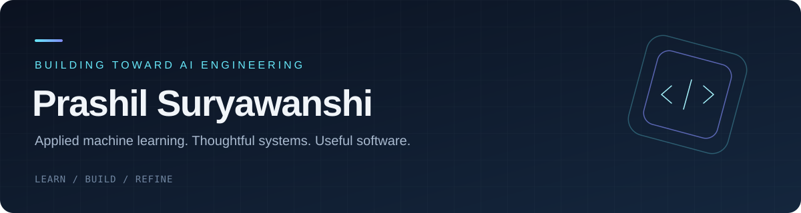

<!-- Profile README — Prashil Suryawanshi -->

  

  <a href="https://github.com/Prashil001?tab=repositories">✦ Projects</a>
  &nbsp; · &nbsp;
  <a href="#-tech-stack">⚡ Tech Stack</a>
  &nbsp; · &nbsp;
  <a href="#-github-activity">📊 Activity</a>
  &nbsp; · &nbsp;
  <a href="https://www.linkedin.com/in/prashil-suryawanshi-a71a5827b/">↗ LinkedIn</a>

  

---

## $ whoami

Hey, I'm **Prashil** — a developer exploring the intersection of **AI engineering, LLM applications, and backend systems**.

I enjoy taking ideas beyond prompts and prototypes: designing APIs, connecting models to useful data, validating outputs, and building interfaces that make systems practical.

- 🧠 Exploring **LLMs, RAG, agentic workflows, and local AI**
- 🛠️ Building with **Python, FastAPI, LangGraph, and PostgreSQL**
- 🔍 Interested in evaluation, reliability, and thoughtful AI product engineering
- 🌱 Always learning by building and breaking things

  
  

## 🚀 Featured projects

<table>
  <tr>
    <td width="62%" valign="top">
      <h3><a href="https://github.com/Prashil001/text2sql-clarifier">Text2SQL Clarifier ↗</a></h3>
      
Ask questions in plain English and turn them into SQL. Uses database schema context, ambiguity detection, clarification prompts, and SQL validation to make text-to-SQL safer and more useful.

      LLM APPLICATIONS · DATABASE INTELLIGENCE
    </td>
    <td width="38%" valign="middle">
      
<code>FastAPI</code> <code>Ollama</code> <code>LangChain</code> <code>PostgreSQL</code> <code>SQL Validation</code>

    </td>
  </tr>
  <tr>
    <td valign="top">
      <h3><a href="https://github.com/Prashil001/WorkFLow-AI">WorkFlow AI ↗</a></h3>
      
A Python backend for workflow planning and management, connecting a structured workflow engine with an API layer.

      WORKFLOW SYSTEMS · BACKEND ENGINEERING
    </td>
    <td valign="middle">
      
<code>Python</code> <code>APIs</code> <code>Workflow Planning</code>

    </td>
  </tr>
  <tr>
    <td valign="top">
      <h3><a href="https://github.com/Prashil001/Cancer-overview-ml">Cancer Overview ML ↗</a></h3>
      
Machine-learning and notebook-based exploration of cancer-related data, with a focus on data analysis and natural language processing.

      APPLIED MACHINE LEARNING · DATA EXPLORATION
    </td>
    <td valign="middle">
      
<code>Machine Learning</code> <code>Jupyter</code> <code>NLP</code>

    </td>
  </tr>
</table>

  

## ⚡ Tech stack

  

  
  
  
  
  
  
  
  

| Area | Tools |
|---|---|
| **AI & LLMs** | LangChain · LangGraph · RAG · MCP · Ollama · LangSmith |
| **Backend & data** | Python · FastAPI · SQLAlchemy · PostgreSQL · REST APIs |
| **App development** | Flutter · Dart · Streamlit |
| **Engineering tools** | Git · GitHub · Docker · Jupyter |

## 📊 GitHub activity

  
  

  

  

---

## 🤝 Let's connect

  
  

  <i>“Build something useful. Understand how it works. Make it better.”</i>

  

